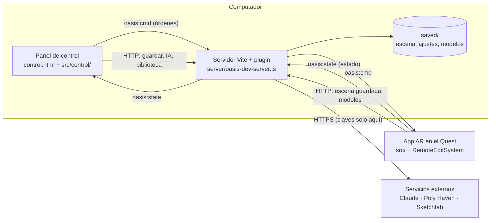

# Oasis WebXR

Experiencia de **realidad aumentada para Meta Quest 3** hecha con
[IWSDK](https://iwsdk.dev) (el framework WebXR de Meta) y un **panel de control
en el computador** para armar la escena en vivo: lo que añades, mueves o pides
con palabras desde el PC aparece al instante en el casco, sin recompilar ni
recargar.

- En el casco: objetos que se agarran con las manos, se escalan con dos manos y
  se apoyan solos sobre las mesas reales (detección de planos).
- En el PC: añadir formas o modelos 3D, editarlos, verlos en un visor 3D con
  gizmo tipo Unity, describir ideas a una IA y guardar la escena.

> **XR / AR**: realidad extendida / aumentada. **IWER**: el emulador de IWSDK
> (un Quest simulado en el navegador). **ECS**: entidad-componente-sistema, el
> modelo de IWSDK (objetos + datos + lógica por fotograma).
> Más en [conceptos de IWSDK](https://iwsdk.dev).

---

## Índice

1. [Requisitos](#requisitos)
2. [Instalación y arranque](#instalación-y-arranque)
3. [Activar las funciones opcionales](#activar-las-funciones-opcionales-claves)
4. [Conectar el Meta Quest](#conectar-el-meta-quest)
5. [Cómo se usa el panel](#cómo-se-usa-el-panel)
6. [Arquitectura](#arquitectura)
7. [Estructura de archivos](#estructura-de-archivos)
8. [Scripts](#scripts)
9. [Solución de problemas](#solución-de-problemas)

---

## Requisitos

- **Node.js** 20.19+, 22.12+ o 24+.
- **Meta Quest 3** (o el emulador incluido) y un computador en la **misma red Wi-Fi**.
- Opcional: una clave de la API de Anthropic (IA) y una clave de Sketchfab (modelos).

## Instalación y arranque

```sh
npm install
npm run dev
```

`npm run dev` levanta el servidor de desarrollo en `https://localhost:8081/` y
abre el emulador de IWSDK. Después:

| Qué | Dónde |
| --- | --- |
| Panel de control (en el PC) | `https://localhost:8081/control.html` |
| App AR (en el Quest) | `https://<IP-Wi-Fi-del-PC>:8081/` |

La primera vez, el navegador avisa «La conexión no es privada»: es el
certificado local de desarrollo. Pulsa **Configuración avanzada → Acceder**
(en el PC y en el Quest).

Si prefieres no abrir el emulador: `npx @iwsdk/cli dev up --no-open`.

## Activar las funciones opcionales (claves)

Crea un archivo **`.env.local`** en la raíz del proyecto (ya está en
`.gitignore`, no se sube a git):

```sh
# IA: «Descríbelo con tus palabras»
ANTHROPIC_API_KEY=sk-ant-...

# Biblioteca: descargar modelos de Sketchfab (una sola clave para todo el equipo)
SKETCHFAB_API_TOKEN=...
```

Reinicia `npm run dev` después de cambiarlo.

| Función | Necesita | Sin la clave |
| --- | --- | --- |
| Panel, visor 3D, guardar, deshacer | Nada | Funciona |
| Biblioteca: Poly Haven y subir tus `.glb` | Nada | Funciona |
| Biblioteca: Sketchfab | `SKETCHFAB_API_TOKEN` (en sketchfab.com → Settings → Password & API) | Se puede buscar, no añadir |
| IA: describir ideas | `ANTHROPIC_API_KEY` (en console.anthropic.com) | El panel muestra cómo configurarla |

Las claves **solo las lee el servidor**: nunca llegan al navegador ni al casco.
Cada idea enviada a la IA es una llamada de pago a la API de Anthropic.

## Conectar el Meta Quest

1. Conecta el Quest a **la misma red Wi-Fi** que el PC.
2. Averigua la IP del PC en esa red. `npm run dev:status` lista las URL de red;
   usa la del adaptador **Wi-Fi** (por ejemplo `https://192.168.1.6:8081/`).
   Las IP de VMware, Hyper-V o WSL (`192.168.184.x`, `192.168.204.x`…) **no
   sirven**: solo existen dentro del PC.
3. Abre esa dirección en el navegador del Quest, acepta el aviso del certificado
   y pulsa **Entrar en AR**.
4. En el panel, el indicador superior pasa a **«En vivo»** (verde oliva).

| Indicador del panel | Significa |
| --- | --- |
| En vivo | El Quest real está conectado y en AR |
| Conectado, fuera de AR | El Quest abrió la app pero no entró en AR |
| Solo emulador · casco sin conectar | Solo responde el Quest simulado del PC |
| Buscando el casco… | Nadie conectado todavía |
| Se perdió la conexión | El casco estaba conectado y dejó de responder |

El botón **«Emulador encendido/apagado»** de la barra superior silencia el
emulador para que el panel solo hable con tu casco real (la elección se guarda).

Para probar sin casco, usa el emulador: [controles de IWER](https://iwsdk.dev/guides/02-testing-experience.html#iwer-controls).

## Cómo se usa el panel

El panel tiene tres columnas:

1. **Añadir un objeto** — (1) elige una forma o pulsa **«Más modelos 3D»**,
   (2) color y tamaño, (3) pulsa dónde ponerlo: *Encima*, *Izquierda*,
   *Derecha*, *Delante*, *Detrás* del objeto que estás editando, o *Frente al
   casco*. Las direcciones son siempre **desde el punto de vista de quien lleva
   el casco**.
2. **Editar un objeto** — elige uno en la lista (o tócalo en el visor 3D; en el
   casco brillará) y muévelo, gíralo, cámbiale el tamaño o el color, ponlo junto
   a otro, duplícalo o elimínalo. «Ajuste preciso» permite escribir medidas en cm.
3. **Visor 3D + ideas** — el visor refleja el casco (incluidas tus mesas y
   paredes reales) con un gizmo para **Mover / Girar / Tamaño**. Debajo,
   **«Descríbelo con tus palabras»** convierte una frase en cambios con IA.

Otras funciones:

- **Biblioteca de modelos 3D**: pestañas *Poly Haven* (gratis), *Sketchfab* y
  *Mis modelos*. También puedes **arrastrar un `.glb`** a cualquier parte del
  panel. Los modelos se guardan en `saved/models/` (funcionan sin internet) y
  conservan el crédito de su autor.
- **Guardar** (Ctrl+S): escribe `saved/oasis-scene.json`. El casco la recupera
  cada vez que abre la app. El panel avisa si hay **cambios sin guardar**.
- **Deshacer** (Ctrl+Z): revierte cualquier cambio, incluido todo lo que hizo
  una idea de la IA.
- **Ayuda** (`?`): explicación rápida y atajos de teclado.
- Tema **claro/oscuro** con el interruptor (por defecto, el del sistema).

Lo que mueves con las manos en el casco también se actualiza en el panel.

---

## Arquitectura

El sistema tiene **tres piezas**. El panel y el casco **nunca se hablan
directamente**: los dos se conectan al servidor de Vite, que hace de puente.



### 1. El canal: el WebSocket de HMR de Vite

Vite ya mantiene un WebSocket abierto con cada página para la recarga en
caliente (HMR). Lo reutilizamos para enviar **eventos personalizados**:

- en el navegador: `import.meta.hot.send(evento, datos)` / `import.meta.hot.on(evento, fn)`;
- en el servidor, el plugin reenvía cada evento a todos los clientes:
  `server.ws.on(evento, d => server.ws.send(evento, d))`.

No hay servidores ni puertos extra, y el Quest ya está conectado a ese canal.
Cambiar el mundo con **órdenes en vivo** (en lugar de editar el JSON de la
escena, que la recargaría) conserva lo que la persona colocó con las manos.

### 2. El protocolo (`src/remote/protocol.ts`)

Un único archivo de tipos que importan las tres piezas.

| Evento | Dirección | Contenido |
| --- | --- | --- |
| `oasis:cmd` | panel → casco | `add`, `duplicate`, `place`, `move`, `setTransform`, `rotate`, `resetRotation`, `scale`, `color`, `rename`, `delete`, `select`, `requestState` |
| `oasis:state` | casco → panel | objetos (posición, rotación, escala, medidas, color, modelo, si están en la mano), posición del casco, superficies reales |
| `oasis:settings` | servidor → todos | ajustes (emulador encendido/apagado) |
| `oasis:bye` | casco → panel | el emulador deja de participar |
| `oasis:notice` | casco → panel | avisos (p. ej. un modelo que no cargó) |

**El panel inventa los ids** de los objetos nuevos. Así el panel, la IA y el
deshacer pueden referirse a un objeto antes de que el casco lo cree, sin
esperar respuestas.

### 3. El casco: `RemoteEditSystem` (ECS)

`src/remote-edit-system.ts`, registrado en `src/index.ts`:

- Su query es *todo lo que tenga `TwoHandsGrabbable`*: los objetos de la escena
  y los creados desde el panel son editables y agarrables por igual.
- Las órdenes entran en una **cola** y se aplican en `update()`, nunca a mitad
  de un fotograma.
- **Colocación relativa al casco**: usa la dirección horizontal de la cámara
  para «derecha/delante» y la caja envolvente (`Box3`) del ancla para «encima»
  o «al lado», alineando las bases para que todo quede apoyado.
- **Modelos 3D**: `AssetManager.loadGLTF()` los carga de forma asíncrona y se
  **normalizan** (mayor dimensión = tamaño elegido, centrados). Las órdenes
  dirigidas a un modelo que aún carga esperan en cola.
- **Estado** cada 0,2 s, solo si cambió (más un latido cada 2 s).
- Al arrancar **carga `saved/oasis-scene.json`** convirtiéndolo en órdenes.
- Detecta si corre en el **emulador** y, si está apagado, deja de participar.
- Sin asignaciones de memoria en `update()` (VR exige 72–90 fps).

### 4. El panel (`control.html` + `src/control/`)

TypeScript sin framework:

- `control.ts`: estado de la interfaz, `render()`, atajos, **deshacer** (guarda
  órdenes inversas antes de cada cambio), cambios sin guardar, elección del
  casco a escuchar (prefiere el Quest real), IA y guardado.
- `viewport.ts`: escena three.js que replica el estado, `OrbitControls` y
  `TransformControls` (gizmo) que envía `setTransform` mientras arrastras.
- `library.ts`: ventana de la biblioteca (búsqueda, descarga, subida).
- `control.css` + `icons.ts`: tema claro/oscuro con variables CSS e iconos SVG.

### 5. El servidor (`server/`)

Plugin de Vite activo solo en `npm run dev` (`apply: 'serve'`):

| Ruta | Para qué |
| --- | --- |
| `GET/POST __oasis/scene` | leer / guardar `saved/oasis-scene.json` |
| `GET/POST __oasis/settings` | ajustes (emulador), guardados en `saved/oasis-settings.json` |
| `POST __oasis/ai` | idea en texto → órdenes (Claude con salida estructurada) |
| `GET __oasis/library/search` · `status` · `list` | buscar en Poly Haven / Sketchfab, estado de claves, modelos guardados |
| `POST __oasis/library/import` · `upload` | descargar un modelo · subir un `.glb` |
| `GET __oasis/models/…` | servir los archivos de cada modelo |

**La IA** (`server/oasis-dev-server.ts`): resume la escena (objetos con medidas,
posición del casco, superficies reales), pide a Claude un plan validado con un
esquema Zod (`client.beta.messages.parse` + `betaZodOutputFormat`) y lo traduce
a las mismas órdenes que usan los botones. Por eso todo lo que hace la IA se
puede deshacer.

**La biblioteca** (`server/library.ts`): Poly Haven por su API pública (sin
clave), Sketchfab con la clave única del proyecto (descomprime con `fflate`), y
subidas validadas. Todo se cachea en `saved/models/<origen>-<id>/` con un
`index.json`. Se usa `saved/` y no `public/` para que escribir archivos no
provoque recargas de la app del casco.

### Decisiones clave

| Decisión | Motivo |
| --- | --- |
| Órdenes en vivo en lugar de editar la escena | No recargar ni perder lo colocado a mano |
| WebSocket de HMR | Ya abierto en todos los clientes; cero dependencias |
| Ids generados por el panel | Encadenar y deshacer sin esperar al casco |
| Claves solo en el servidor | El navegador nunca las ve |
| Detección del emulador | Su navegador se hace pasar por un Quest |
| Panel y servidor solo en desarrollo | `npm run build` genera solo la app del casco |

## Estructura de archivos

```
iwsdk.config.json            configuración IWSDK (AR, manos, planos, emulador)
vite.config.ts               activa el plugin oasisDevServer
control.html                 página del panel de control
server/
  oasis-dev-server.ts        plugin de Vite: relay, guardado, ajustes, IA
  library.ts                 biblioteca de modelos (Poly Haven, Sketchfab, subidas)
src/
  index.ts                   crea el mundo y registra los sistemas
  remote/protocol.ts         tipos y eventos compartidos
  remote-edit-system.ts      sistema del casco que obedece al panel
  surface-snap.ts            apoyar objetos sobre mesas al soltarlos
  uniform-grab-scale.ts      escalado uniforme con dos manos
  grab-rotation-fix.ts       corrección del punto de agarre al girar la muñeca
  control/                   panel: control.ts, viewport.ts, library.ts, css, iconos
  scene-assets/              geometría de las formas de la escena
public/scenes/               escena inicial (*.iwsdk.scene.json)
saved/                       escena guardada, ajustes y modelos descargados
```

## Scripts

| Comando | Qué hace |
| --- | --- |
| `npm run dev` | Servidor de desarrollo + emulador |
| `npm run dev:status` | Estado del servidor y URL de red |
| `npm run dev:down` | Detener el servidor |
| `npm run typecheck` | Comprobar tipos (app + servidor) |
| `npm run build` | Compilar la app del casco para producción |

## Solución de problemas

| Problema | Solución |
| --- | --- |
| El Quest no carga la página | Usa la IP del **Wi-Fi**, no la de VMware/WSL. Permite Node.js en el Firewall de Windows (redes privadas). |
| El panel dice «Solo emulador» | El Quest no está conectado: abre la app en el casco o apaga el emulador con su botón. |
| `npm run dev` no arranca y el puerto 8081 no responde | Hay un proceso colgado: cierra los procesos `node` del proyecto (o `npm run dev:down`) y vuelve a lanzarlo. |
| La IA dice que falta la clave | Añade `ANTHROPIC_API_KEY` a `.env.local` y reinicia. |
| No puedo añadir modelos de Sketchfab | Añade `SKETCHFAB_API_TOKEN` a `.env.local` y reinicia; algunos modelos no permiten descarga. |
| Subo un `.gltf` y lo rechaza | Usa `.glb`: un `.gltf` con archivos aparte no se puede subir solo. |
| Perdí cambios al recargar el casco | Solo se conserva lo **guardado** (Ctrl+S). |

Licencias de modelos: Poly Haven es CC0. En Sketchfab cada modelo tiene su
licencia (algunas son no comerciales o exigen atribución); el crédito se guarda
con cada modelo.

Guías de IWSDK: [escena mínima](https://iwsdk.dev/guides/01b-minimal-scene.html) ·
[probar la experiencia](https://iwsdk.dev/guides/02-testing-experience.html).
